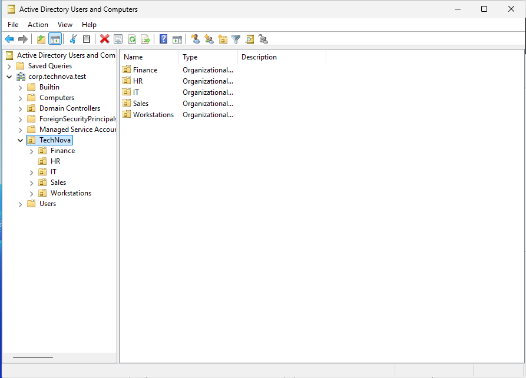
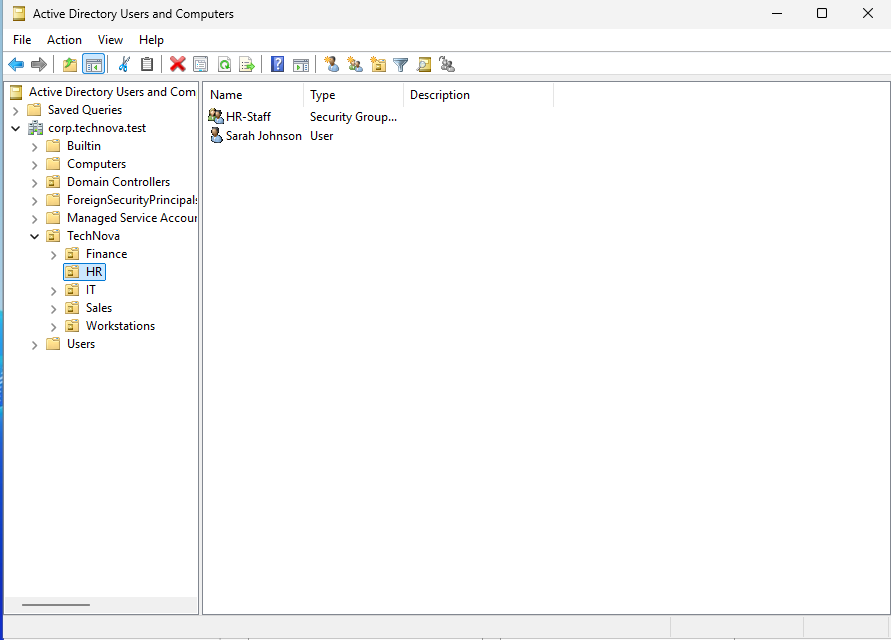
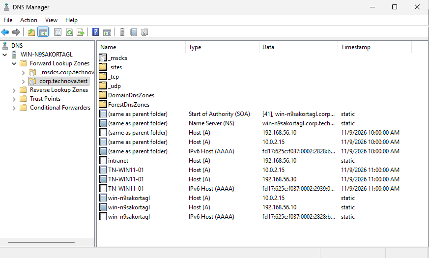
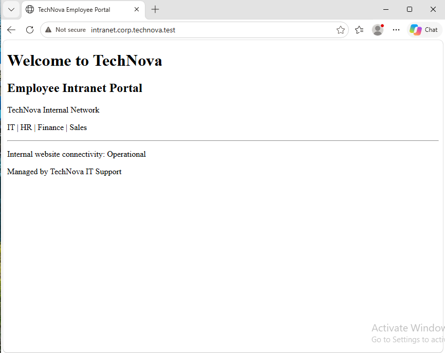
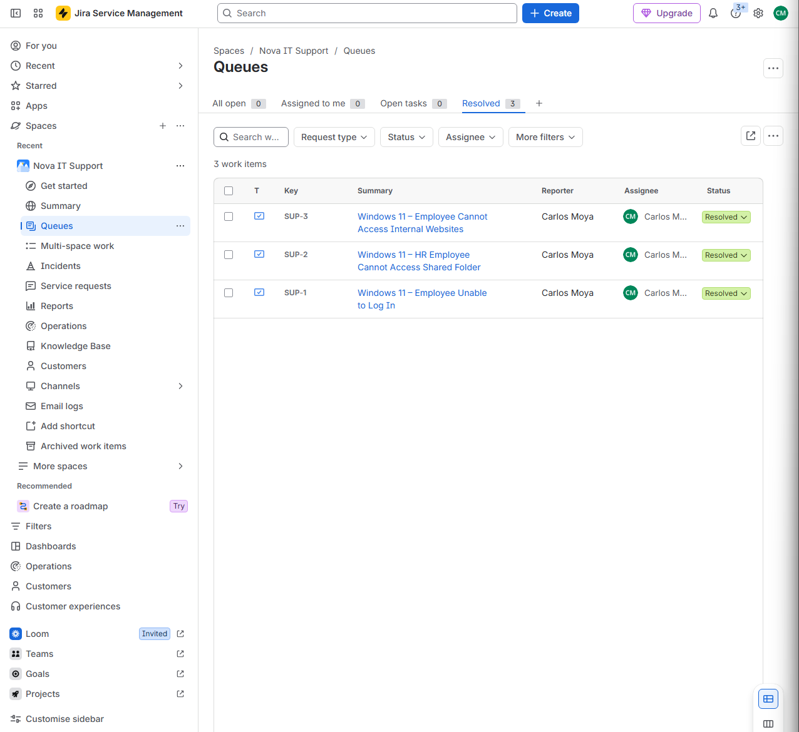

# IT Help Desk Lab

**Windows Server 2025 | Active Directory | Windows 11 | DNS | IIS | Jira Service Management**

## Project Overview

This project simulates a small enterprise IT environment to demonstrate hands-on experience with Windows administration, Active Directory, network troubleshooting, and IT support ticket management.

The lab focuses on common responsibilities of an entry-level Help Desk or Desktop Support technician, including managing employee accounts, troubleshooting workstation issues, configuring internal network services, and documenting technical resolutions.

## Lab Environment

| Component | Configuration |
|---|---|
| Virtualization | Oracle VirtualBox |
| Server | Windows Server 2025 |
| Workstation | Windows 11 |
| Domain | `corp.technova.test` |
| Domain Controller | `192.168.56.10` |
| Workstation | `192.168.56.30` |
| Ticketing System | Jira Service Management |

## Active Directory Administration

Configured Active Directory Domain Services to simulate employee account management in a business environment.

**Tasks completed:**
- Created departmental Organizational Units (IT, HR, Finance, Sales, and Workstations).
- Created and managed employee accounts.
- Configured departmental security groups and memberships.
- Practiced password resets and account enable/disable procedures.
- Worked with Group Policy Management.

### Active Directory Screenshots

## Windows 11 Workstation Support

Configured and tested a Windows 11 workstation connected to the simulated corporate domain.

**Tasks completed:**
- Verified domain authentication.
- Configured TCP/IP settings.
- Tested connectivity to the domain controller.
- Troubleshot DNS name resolution.
- Used Windows command-line troubleshooting tools.

**Commands used:** `ipconfig /all`, `ping`, `nslookup`, `whoami`

## DNS and IIS Configuration

Configured Windows DNS and Internet Information Services (IIS) to support an internal company website.

**Tasks completed:**
- Created a DNS Host (A) record for `intranet.corp.technova.test`.
- Installed and configured IIS.
- Created a basic employee intranet webpage.
- Configured the website's default document.
- Verified access from the Windows 11 workstation.

### DNS and IIS Screenshots

## Jira Service Management

Created and resolved three simulated IT support tickets to practice incident management and technical documentation.

| Ticket | Issue | Status |
|---|---|---|
| SUP-1 | Employee unable to log in | Resolved |
| SUP-2 | HR employee unable to access shared folder | Resolved |
| SUP-3 | Employee unable to access internal website | Resolved |

Each ticket includes the reported issue, troubleshooting actions, and documented resolution.

### Jira Ticket Evidence

## Skills Demonstrated

- Active Directory user and group administration
- Windows 11 troubleshooting
- Windows Server administration
- DNS and TCP/IP troubleshooting
- IIS configuration
- Domain authentication
- IT ticket management and documentation
- Technical problem-solving

## Project Summary

This lab provided hands-on practice supporting a simulated Windows enterprise environment, troubleshooting common employee issues, and documenting resolutions using Jira Service Management.

The project was developed to strengthen practical skills relevant to entry-level IT Help Desk and Desktop Support positions.

*All employees and support incidents are fictional and used for educational purposes.*
